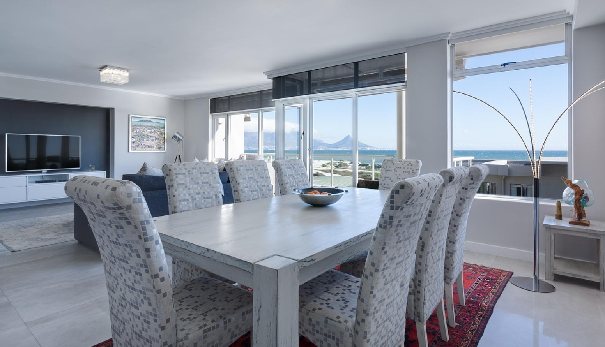
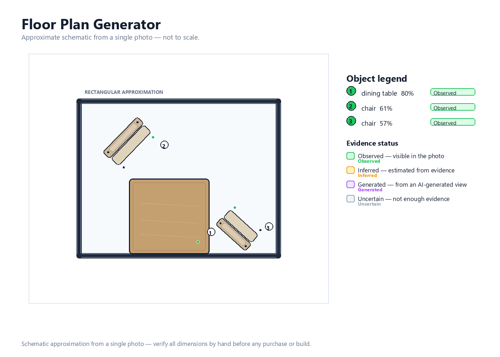

# Floor Plan Generator

A web application that accepts **one RGB photograph of an indoor room** and produces an
**approximate 2D top-down floor plan** as a structured spatial hypothesis plus a
downloadable schematic PNG.

> **This is an approximation system, not an architectural measurement tool.**
> A single RGB image cannot recover hidden geometry or exact metric dimensions.
> The pipeline distinguishes **observed** evidence from **inferred** and **uncertain**
> elements, and never presents inferred geometry as verified.

## Background

### Problem context

Converting a photograph of an indoor room into a usable floor plan is a
spatial-reconstruction problem. A single RGB image records only the light that
reached the camera from a fixed viewpoint: surfaces facing the camera are
visible, but anything behind them, outside the frame, or occluded by furniture
is absent. Conventional object detection can label what is visible (a chair, a
table), but it cannot by itself establish where those objects sit on the floor,
how large the room is, or where walls run — especially walls not facing the
camera.

Manually creating a floor plan requires measuring wall lengths, room proportions,
and furniture positions with a tape measure, then translating those measurements
into a top-down drawing. For a single room this takes minutes to hours; for an
entire property it can take days. The result depends on the measurer's skill and
care.

This project addresses a narrower problem: given one photograph of an indoor
room, produce a **schematic top-down floor plan** that estimates room boundary,
visible furniture positions, and footprint sizes — while explicitly reporting
which parts are observed, which are inferred, and which are uncertain.

### Information categories in the output

Every element in the generated floor plan is assigned one of four evidence
statuses:

| Status | Meaning | Basis |
|---|---|---|
| **Observed** | Directly visible in the photograph | Pretrained object detector matched a COCO class (bed, couch, chair, dining table, TV, etc.) |
| **Inferred** | Estimated from visible evidence under stated assumptions | Shape-based candidate from classical CV; floor position projected from image evidence through an estimated floor plane |
| **Generated** | Derived from an AI-generated candidate view | Not used by the current pipeline — always 0 generated views |
| **Uncertain** | Not enough evidence to decide | Object above floor level, floor plane unavailable, opening candidate not confirmed |

### What the system does NOT do

- **No metric dimensions.** A single RGB photo without camera intrinsics or a
  known reference object cannot yield reliable meters. Room dimensions and object
  sizes are reported as normalized plan units (0–1), never fabricated as meters
  or feet.
- **No hidden geometry.** Walls behind the camera, occluded objects, and closed
  doors are never reconstructed. Hidden objects are never labeled as detected.
- **No guaranteed completeness.** Detectors are heuristic; missed furniture is
  normal. The COCO detector does not recognize wardrobes, cabinets, doors, or
  windows as those classes.
- **Depth is relative, not metric.** The default depth estimator uses classical
  image cues (horizon/gradient geometry). It is a unitless relative estimate
  used only for coarse near/far ordering and floor-plane projection.
- **Rectangular geometry is an approximation.** A projective homography maps a
  visible floor quadrilateral to straight-edged plan coordinates, but this does
  not verify that the real room is rectangular or recover unseen corners.

### Intended use cases

- Producing a rough, schematic floor plan from a single room photo as a
  starting sketch
- Understanding approximate furniture layout and room proportions from one image
- Educational or exploratory use where exact measurements are not required

### Not suitable for

- Construction, renovation, or real-estate documentation
- Any application requiring metric accuracy or verified wall positions
- Rooms where most furniture or walls are occluded or outside the frame

## What the system produces

**Input:** One RGB photograph (PNG, JPEG, WebP, BMP, or GIF, max 15 MB, max
4096 px per dimension) of an indoor room.

**Output:**

1. A structured spatial hypothesis (JSON) containing:
   - Estimated room boundary polygon (normalized plan coordinates, 0–1)
   - Detected/inferred objects with labels, positions, footprints, and evidence
     status
   - Opening candidates (doors/windows) marked uncertain
   - Uncertainty summary with assumptions and open questions
   - Provenance metadata (reasoning provider, depth method, detection model,
     generated views used)
2. A downloadable schematic floor-plan PNG (1400 × 1000 px) showing walls,
   furniture symbols, numbered markers, and an evidence-status legend.
3. A downloadable JSON layout file with the full hypothesis.

## How it works

The backend pipeline is synchronous, CPU-only, and deterministic. No paid AI
provider is required. The frontend calls the backend API, polls for completion,
and displays the result.

### System architecture

```mermaid
flowchart TD
    A[User uploads RGB photo<br/>Frontend React + Vite] --> B[POST /api/generations<br/>FastAPI backend]
    B --> C[Image validation<br/>decode, size/format checks, EXIF, RGB]
    C --> D[Depth estimation<br/>classical relative depth, horizon cue]
    D --> E[Normal estimation<br/>derived from depth, assumed pinhole]
    E --> F[Feature extraction<br/>classical CV, gradient regions,<br/>connected components]
    F --> G[Floor-plane estimation<br/>segment visible floor, IPM projection]
    G --> H[Object detection<br/>SSDlite-MobileNetV3-Large COCO<br/>optional, CPU]
    H --> I[Spatial hypothesis<br/>deterministic reasoning,<br/>evidence statuses]
    I --> J[Floor-plan rendering<br/>deterministic PNG, 1400×1000]
    J --> K[GET /api/generations/{id}/floorplan<br/>PNG + JSON result]
    K --> L[Frontend displays result<br/>evidence legend, downloads, Q&A]
```

### Processing pipeline

```mermaid
flowchart LR
    subgraph Input ["1. Input & validation"]
        I1[RGB image] --> I2[validate_and_normalize<br/>decode • EXIF • size limits • RGB]
    end
    subgraph CV ["2. Computer vision (classical, CPU-only)"]
        C1[Depth estimation<br/>horizon cue • relative depth] --> C2[Normal estimation<br/>derived from depth • pinhole model]
        C2 --> C3[Feature extraction<br/>gradient regions • components<br/>generic geometric labels]
        C3 --> C4[Floor-plane estimation<br/>segment floor • IPM projection<br/>homography or rectangular fallback]
    end
    subgraph Detection ["3. Object detection (optional)"]
        D1[TorchVision SSDlite-MobileNetV3-Large<br/>COCO-2017 • local CPU<br/>confidence ≥ 0.35]
    end
    subgraph Reasoning ["4. Spatial hypothesis (deterministic)"]
        R1[Build hypothesis<br/>OBSERVED / INFERRED / UNCERTAIN<br/>footprint priors • layout validation]
    end
    subgraph Output ["5. Rendering & API"]
        O1[Render floor-plan PNG<br/>walls • furniture symbols • legend]
        O2[Serve JSON + PNG via REST API]
    end

    I2 --> C1
    C4 --> D1
    C4 --> R1
    D1 --> R1
    R1 --> O1
    O1 --> O2
```



### Pipeline stages

Each stage below describes its purpose, input, methodology, output, and limitations.

#### 1. Image acquisition and preprocessing

- **Purpose:** Accept an uploaded image, verify it is a real decodable image, and normalize it for downstream models.
- **Input:** Raw bytes of an uploaded file (PNG, JPEG, WebP, BMP, or GIF).
- **Methodology:** `validate_and_normalize` in `backend/app/services/image_validation.py` decodes with Pillow, verifies the image is valid, enforces format allow-list and size limits (max 15 MB, max 4096 px per dimension), applies EXIF orientation normalization, and converts to RGB. Filenames and browser-supplied MIME types are never trusted.
- **Output:** A `ValidatedImage` (RGB Pillow image, format, width, height).
- **Limitations:** Rejects non-images, oversize files, and unsupported formats. Does not upscale or enhance image quality.

#### 2. Depth estimation

- **Purpose:** Estimate coarse relative depth from a single RGB image to support floor-plane projection and near/far ordering.
- **Input:** RGB image.
- **Methodology:** `ClassicalDepthCueEstimator` in `backend/app/services/depth.py`. The estimator works at a max working dimension of 320 px. It finds a horizon proxy (the row with the strongest horizontal edge span in the middle band of the image using Sobel edge detection), then builds a relative depth map:
  - Floor pixels (below horizon): depth cue `d ∝ 1 / (y − horizon)` — pixels near the horizon are far, pixels at the bottom are near.
  - Upper region (walls/ceiling): depth grows with distance from the horizon.
- **Output:** `DepthResult` — a unitless relative depth map (larger = farther), horizon row, image dimensions. Depth is restored to original resolution.
- **Limitations:** Unitless relative estimate, NOT metric depth. Cannot be used for measurements. Horizon detection can fail on images without a clear wall/floor boundary. No model download, no GPU, fully deterministic.

#### 3. Surface normal estimation

- **Purpose:** Derive surface orientation cues from the relative depth map to distinguish floor-like (near-horizontal) surfaces from vertical walls.
- **Input:** `DepthResult`.
- **Methodology:** `DepthNormalEstimator` in `backend/app/services/normals.py`. Each pixel is back-projected to camera space under an assumed pinhole model (FOV 60°, a common phone-camera approximation; true intrinsics are unknown):
  ```
  X = (x − cx) · d / fx,  Y = (y − cy) · d / fy,  Z = d
  ```
  Surface normals are estimated from the cross product of neighboring back-projected points. Border pixels and pixels with near-zero depth are marked invalid.
- **Output:** `NormalsResult` — unit normal vectors per pixel, validity mask, assumed intrinsics (FOV, fx, fy, cx, cy).
- **Limitations:** Derived from a relative depth map and assumed intrinsics — not ground truth. Used only as a weak cue (e.g., floor_pixel_ratio for near-horizontal surfaces).

#### 4. Object and feature extraction

- **Purpose:** Identify visual evidence in the photograph — both semantically labeled objects (via detector) and generic geometric regions (via classical CV).
- **Input:** RGB image, depth result, normals result.
- **Methodology:** Two sources:
  - **Classical CV** (`ClassicalFeatureExtractor` in `backend/app/services/features.py`): gradient-edge thresholding, morphological closing, connected-component analysis. Regions spanning opposite image borders are discarded (likely background/floor, not furniture). Labels are generic geometric descriptions: "wide surface", "tall object", "compact object", "vertical structure", "wall feature", "door or window candidate". Bounding boxes and centroids are in normalized image coordinates (0–1). Max working dimension 256 px.
  - **Object detection** (`TorchVisionDetector` in `backend/app/services/detection.py`): pretrained SSDlite-MobileNetV3-Large on COCO-2017, runs locally on CPU, no paid API. Weights (~22 MB) download from PyTorch model zoo on first use. Confidence threshold 0.35, max 100 detections, duplicate suppression at IoU ≥ 0.85. Indoor-relevant classes: bed, couch, chair, dining table, TV, person, bottle, cup, laptop, potted plant, toilet. Unsupported classes (never fabricated): desk, cabinet, wardrobe, shelf, door, window.
- **Output:** `FeatureExtractionResult` — visual evidence objects with labels, bboxes, centroids, colors, area fractions, strength scores, floor-level flags; plus floor polygon and plan transform. Detection results are merged in the pipeline stage.
- **Limitations:** Classical labels are geometric descriptions, not furniture claims. Detector scores are not calibrated probabilities. Image-space boxes are never treated as world-space positions — floor-plane projection happens separately.

#### 5. Floor-plane estimation

- **Purpose:** Establish an approximate ground-plane coordinate system from visible floor evidence.
- **Input:** RGB image, depth result, normals result, horizon row.
- **Methodology:** `FloorPlaneEstimator` in `backend/app/services/floorplane.py`. Segments the likely floor region using depth/normals/horizon cues (floor normals point roughly upward in camera space). Finds wall-floor intersection edges. Projects the visible floor region to normalized plan space via inverse-perspective mapping:
  ```
  X = (x − cx) / (y − horizon),  Y = 1 / (y − horizon)
  ```
  Uses a projective homography when a usable floor quadrilateral exists; otherwise falls back to an axis-aligned rectangular approximation with aspect ratio clamped to [0.65, 1.6].
- **Output:** `FloorPlaneResult` — transform, floor polygon (plan coords), wall lines, vanishing point, camera pitch, quality ("good"/"poor"/"none").
- **Limitations:** The visible floor region, not a verified complete room boundary. Hidden walls are absent, not fabricated. When evidence is thin, quality is "poor" or "none" and objects remain unplaced.

#### 6. AI-based spatial reasoning

- **Purpose:** Convert extracted visual evidence into a validated spatial hypothesis with evidence statuses and uncertainty reporting.
- **Input:** `FeatureExtractionResult`, detection results.
- **Methodology:** `build_hypothesis` in `backend/app/services/hypothesis.py` — **deterministic fallback reasoning, no AI provider.** Rules:
  - Pretrained detector outputs are genuine observations: `OBSERVED` status with model confidence and normalized image bbox.
  - Floor-level objects receive an approximate plan position projected from the bbox bottom-centre (ground-contact point) through the estimated floor plane. Placement is `INFERRED` — an estimate, not a measurement.
  - Objects above floor level are `UNCERTAIN` with no position.
  - Room boundary is the projectively rectified visible floor region or a labeled rectangular approximation (`INFERRED`); hidden walls are absent.
  - Openings are `UNCERTAIN` border-adjacent edge candidates.
  - Footprints use class priors (`backend/app/services/footprint.py`) scaled by projected bbox base width when reliable; always labeled approximate.
  - Orientation assumed down-plan (0 rad); not recoverable from a single photo.
  - Layout validation (`backend/app/services/layout.py`): fit footprint inside estimated room, resolve overlaps, search for nearest clear position; leave unplaced if no clear position exists.
- **Output:** `SpatialHypothesis` — room boundary, room geometry, objects, openings, uncertainty summary, provenance.
- **Limitations:** No LLM reasoning is invoked. `reasoning_provider` is always `"deterministic-fallback"` and `generated_views_used` is always `0` in the current pipeline. All positions, footprints, and orientations are single-view estimates with heuristic confidences.

#### 7. Uncertainty estimation

- **Purpose:** Represent confidence and uncertainty for every element of the hypothesis.
- **Methodology:** Heuristic confidence scores (not calibrated probabilities):
  - Detection confidence from the COCO model (0–1).
  - Ground-contact confidence based on distance below horizon and object size.
  - Footprint confidence based on class prior and projected width evidence.
  - Overall uncertainty level: "high" (few/no objects), "medium" (4+ objects).
  - Assumptions and open questions are listed explicitly.
- **Output:** `UncertaintySummary` with overall level, assumptions, and open questions; per-object `evidence_status`, `confidence`, `placement_confidence`, `footprint_confidence`, `uncertainty_reason`.
- **Limitations:** All confidences are heuristic, not calibrated. No uncertainty propagation between stages. Hidden geometry is reported as absent, not uncertain.

#### 8. Viewpoint planning and novel-view generation

- **Status:** NOT IMPLEMENTED in the current pipeline.
- The codebase configures `NOVEL_VIEW_ENABLED` (default `false`) and `GROQ_API_KEY` (optional), but `run_pipeline` does not invoke either. The `Provenance` record always reports `generated_views_used: 0` and `reasoning_provider: "deterministic-fallback"`. No viewpoint-planning loop or image-generation model is integrated.

#### 9. Floor-plan generation

- **Purpose:** Render the spatial hypothesis as a schematic 2D floor-plan PNG.
- **Input:** `SpatialHypothesis`.
- **Methodology:** `render_floorplan` in `backend/app/services/renderer.py`. Deterministic Pillow rendering at 1400 × 1000 px. Draws room perimeter walls, wall segments, opening markers, furniture symbols (class-specific top-down silhouettes), numbered evidence markers, an evidence-status legend (OBSERVED green / INFERRED orange / GENERATED purple / UNCERTAIN gray), "not to scale" footer, and a rectangular-approximation label when applicable. Equal pixel scale on both plan axes avoids stretching.
- **Output:** PNG bytes (1400 × 1000), served at `GET /api/generations/{job_id}/floorplan`.
- **Limitations:** Schematic approximation, not to scale. job_id is never drawn on the image. Deterministic: same hypothesis always produces identical bytes.

#### 10. System integration

- **Backend:** FastAPI application (`backend/app/main.py`). Routes mounted under `/api`. In-memory job store with TTL-based artifact cleanup. Does not survive restarts; single-worker local prototype.
- **Frontend:** React 19 + TypeScript + Vite (`frontend/`). Single-page upload → process → results flow. Polls the API every 1 second (5-minute timeout). Displays evidence legend, Q&A panel, and download buttons for PNG and JSON layout.
- **API endpoints:**
  - `POST /api/generations` — upload image, returns `job_id`
  - `GET /api/generations/{job_id}` — poll status and result
  - `GET /api/generations/{job_id}/floorplan` — download PNG
  - `POST /api/generations/{job_id}/ask` — simple Q&A about the result
  - `GET /api/health` — health check

## Visuals

### Input vs. generated output

The images below are genuine outputs from the current implementation, produced by running the backend pipeline on a real indoor-room photograph.





The input photograph shows a living/dining area with a dining table and chairs. The generated floor plan is a rectangular approximation showing the estimated table and chair positions, with evidence-status markers (all `Observed` in this example because the objects were detected by the COCO detector). The plan is explicitly labeled "RECTANGULAR APPROXIMATION" and "not to scale."

## Quick start

Run the backend and frontend in **two separate PowerShell terminals**. In each terminal, start from the project root.

### Prerequisites

- Python 3.13 (verified with 3.13.12; required by the pinned CV/AI stack)
- Node.js 24 and npm 12 (verified)
- Git

### Backend

In Terminal 1:

```powershell
cd backend
python -m venv .venv
.venv\Scripts\Activate.ps1
python -m pip install -r requirements.txt
# optional: copy .env.example to .env and set GROQ_API_KEY (not required)
python -m uvicorn app.main:app --host 127.0.0.1 --port 8000
```

### Frontend

In Terminal 2, starting from the project root:

```powershell
cd frontend
npm install
npm run dev        # http://localhost:5173
```

### Tests

Run each test suite from a separate terminal, starting from the project root.

Backend:

```powershell
cd backend
python -m pytest
```

Frontend:

```powershell
cd frontend
npm test
```

## Repository layout

```text
├── frontend/        React + TypeScript + Vite application (presentation only)
├── backend/         FastAPI + Python computer-vision processing pipeline
│   └── app/
│       ├── api/         HTTP routes
│       ├── core/        configuration, logging, error handling
│       ├── schemas/     Pydantic spatial + API contracts
│       ├── services/    CV stages (validation, depth, detection, floor plane, layout, renderer)
│       └── main.py      FastAPI application factory
├── artifacts/       local, temporary processing artifacts (git-ignored)
├── docs/            architecture, API, limitations, images
│   ├── architecture.md
│   ├── api.md
│   ├── limitations.md
│   └── images/
│       ├── sample-input-upload.png
│       └── sample-generated-floorplan.png
└── README.md
```

## Documentation

- [Architecture](docs/architecture.md) — pipeline, modules, data flow, coordinate conventions, job model
- [API reference](docs/api.md) — endpoints, schemas, status model, errors
- [Limitations](docs/limitations.md) — what the system cannot guarantee

## Configuration

Backend settings live in `backend/.env` (see `backend/.env.example`). The baseline pipeline works **without any API key**: optional Groq reasoning and novel-view generation are not invoked by `run_pipeline`, and a deterministic evidence-based fallback is always used. Optional novel-view generation is disabled by default.

No credentials are ever exposed to the frontend bundle.

## License

MIT License — see [LICENSE](LICENSE).